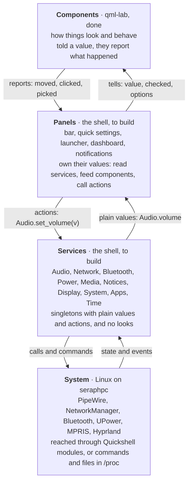
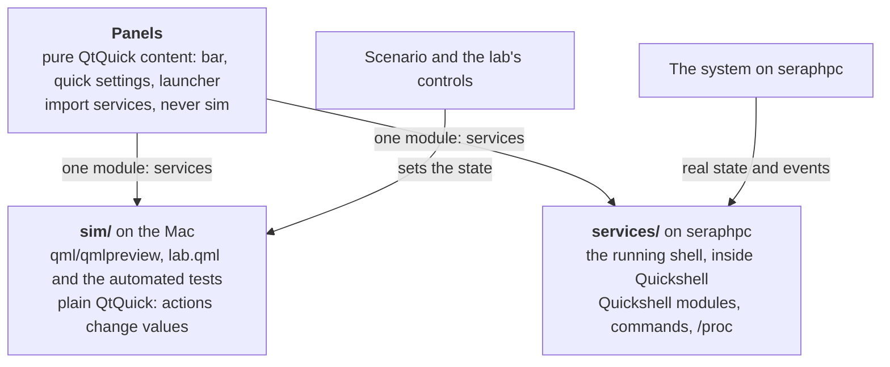
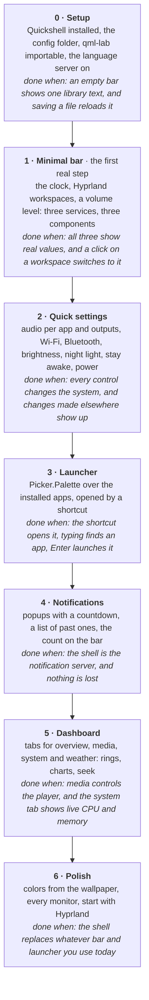

# From qml-lab to the shell: the plan

The component library is finished. This plan covers the next phase: a desktop shell for seraphpc (EndeavourOS + Hyprland), built from the library with Quickshell. Last updated November 27, 2026.

## Where we are

The foundation is the **Tui style**: a Qt Quick Controls style — about 40 controls — painted from Material 3 tokens, documented in `ARCHITECTURE.md` and `DESIGN.md` and shown in `gallery/`. Qt's Templates own behaviour; Tui owns the look. The shell is built from these parts; no panel draws its own buttons, rows or bars.

| Layer | What's in it |
| --- | --- |
| `lib/theme/` | M3 tokens: Colors, States, Shape, Spacing, Motion, Type |
| `lib/Tui/` | the style — every Qt Quick Control (Button, Slider, Switch, TextField, ComboBox, TabBar, Menu, Dialog, …) themed from the tokens |
| `lib/primitives/` | things Qt has no control for: Divider, Keycap, Avatar, Combo, Image |
| `shell/` | the shell itself: `sim/` (the mock spine), `panels/`, `lab.qml` |

What this gives the shell: a panel only arranges controls and connects them to data. Looks, states, keyboard rules, popups and motion are already decided and tested.

**Still to build on Tui** — the shell needs these and Qt has no control for them, so they are built from primitives + tokens when their milestone arrives (the panel tables below already name them): charts (`Chart.Spark`, `Chart.Columns`), the fuzzy launcher list (`Picker.Palette`), circular and seek ranges (`Range.Ring`, `Range.Seek`), `Badge.Count`, empty/error feedback (`Feedback`), titled list sections (`Section`), and the list and tile buttons (`Button.ListItem`, `Button.Tile`). The plain Qt Quick Controls they sit beside — buttons, slider, switch, fields, tabs, menu — come from Tui today.

## The architecture

The shell adds two layers on top of the library: services that talk to the system, and panels that connect services to components. Each layer knows only its neighbours, so a component never learns what Wi-Fi is, and a service never learns what a slider looks like.



Values travel up and events travel down. A volume change in PipeWire reaches the `Audio` service, the quick settings panel tells its slider the new value, and a drag on the slider goes back down as `Audio.set_volume(v)`.

## Setup on seraphpc

The shell runs only on seraphpc (EndeavourOS + Hyprland): Quickshell is Linux and Wayland only. The Mac stays the place for the library and the gallery. Everything below follows Quickshell's current docs, v0.3.2.

1. **Install the release package.** Arch ships Quickshell in its official repositories, so on EndeavourOS it's `sudo pacman -S quickshell` ([install guide](https://quickshell.org/docs/v0.3.2/guide/install-setup/)). The AUR `quickshell-git` tracks the master branch instead, but the docs warn it can break whenever Qt updates; the release package avoids that.
2. **Create the config folder.** Quickshell looks for `~/.config/quickshell/shell.qml` as the default config, or one config per subfolder (`~/.config/quickshell/<name>/shell.qml`, started with `qs -c <name>`). Any other folder can be run with `qs -p <path>` ([introduction](https://quickshell.org/docs/v0.3.2/guide/introduction/)).
3. **Make qml-lab importable.** The shell needs `theme`, `Tui` and `primitives` from the qml-lab repo, and the Tui style selected (`QQuickStyle.setStyle("Tui")`). How exactly is an open question (below); the repo itself stays the single source of the library.
4. **Turn on the language server.** An empty `.qmlls.ini` next to `shell.qml` is replaced by Quickshell with a managed qmlls config; it stays out of git, since its content differs per machine.
5. **Work with live reload.** Quickshell reloads the shell whenever a file is saved, the same loop as `qmlpreview` (`make watch`) on the Mac.
6. **Start it with Hyprland**: `exec-once = qs` in the Hyprland config, once the bar works.

## Services

Quickshell v0.3.2 already covers most of the system: 11 of the 14 needs below map to one of its modules, so most of our services are thin wrappers. Only brightness, night light and CPU and memory need our own code, built on Quickshell's `Process` (run a command) and `FileView` (read a file) ([type list](https://quickshell.org/docs/v0.3.2/guide/install-setup/)).

| Need | Comes from | Our service |
| --- | --- | --- |
| volume, outputs, per-app volume | `Quickshell.Services.Pipewire` | `Audio` |
| media playing, seek | `Quickshell.Services.Mpris` | `Media` |
| notifications | `Quickshell.Services.Notifications` | `Notices` |
| battery, power profiles | `Quickshell.Services.UPower` | `Power` |
| Wi-Fi networks, connect | `Quickshell.Networking` (NetworkManager) | `Network` |
| Bluetooth devices | `Quickshell.Bluetooth` | `Bluetooth` |
| tray icons and their menus | `Quickshell.Services.SystemTray`, `Quickshell.DBusMenu` | `Tray` |
| workspaces, focused window | `Quickshell.Hyprland` | `Workspaces` |
| stay awake | `IdleInhibitor` in `Quickshell.Wayland` | `Session` |
| apps for the launcher | `DesktopEntries` in `Quickshell` | `Apps` |
| the time | `SystemClock` in `Quickshell` | `Time` |
| brightness | none: a command, e.g. `brightnessctl` | `Display` |
| night light | none: a command (tool to choose) | `Display` |
| CPU and memory | none: read `/proc` | `System` |

**The shape of every service** is the same, whatever it wraps:

- a **singleton** (one instance, reachable from every panel), in its own `services/` folder of the shell
- **plain values** the panels bind to: `Audio.volume` (0–100), `Audio.muted`, `Network.connected`, never the raw Quickshell objects
- **actions** the panels call: `Audio.set_volume(v)`, `Network.connect(name, password)`
- **no looks and no components**: a service knows the system, never how it's shown

That keeps the library's contract intact: a panel reads `Audio.volume` into a `Range.Slider` and sends its `moved(value)` to `Audio.set_volume`. Swapping how a value is read (a module today, a command tomorrow) never touches a panel.

## Service contracts

Every service has a fixed contract: the values panels read and the actions they call. Panels depend only on this contract, which is what lets a simulated service stand in for a real one (next section). These are the proposed contracts; names follow the library's snake_case, values are read-only, and lists hold plain objects.

| Service | Values (read-only) | Actions |
| --- | --- | --- |
| `Time` | `now` (date), `clock` (09:27), `day` (thursday, november 26) | none |
| `Workspaces` | `list` (`{ id, name, focused, occupied }`), `focused_id` | `focus(id)` |
| `Audio` | `volume` (0–100), `muted`, `output`, `outputs` (`{ name, description, active }`), `apps` (`{ name, volume }`) | `set_volume(v)`, `toggle_mute()`, `set_output(name)`, `set_app_volume(name, v)` |
| `Media` | `playing`, `title`, `artist`, `position` (s), `length` (s), `can_seek` | `play_pause()`, `next()`, `previous()`, `seek(s)` |
| `Notices` | `items` (`{ id, app, summary, body, time, urgency }`), `unread`, `do_not_disturb` | `dismiss(id)`, `clear()`, `invoke(id, action)`, `set_do_not_disturb(on)` |
| `Power` | `battery` (0–100), `charging`, `on_battery`, `minutes_left`, `profile`, `profiles` | `set_profile(name)` |
| `Network` | `enabled`, `connected`, `ssid`, `strength` (0–100), `networks` (`{ ssid, strength, secured, saved }`), `scanning`, `error` | `set_enabled(on)`, `scan()`, `connect(ssid, password)`, `disconnect()`, `forget(ssid)` |
| `Bluetooth` | `available` (an adapter exists), `enabled`, `devices` (`{ id, name, kind, paired, connected, battery }`), `scanning` | `set_enabled(on)`, `scan()`, `pair(id)`, `connect(id)`, `disconnect(id)` |
| `Display` | `brightness` (0–100), `night_light` | `set_brightness(v)`, `set_night_light(on)` |
| `Session` | `stay_awake` | `set_stay_awake(on)`, `lock()` |
| `System` | `cpu` (0–100), `cpu_history` (60 values), `cores` (per core), `memory` (0–100) | none |
| `Apps` | `entries` (`{ id, title, description, icon }`) | `launch(id)` |
| `Tray` | `items` (`{ id, icon, title }`) | `activate(id)`, `open_menu(id)` |

Two rules keep contracts honest:

- **Errors are values, not crashes.** A failed connect sets `Network.error` (wrong password), which a panel shows with `Field.Password`'s error state or `Feedback.Error`.
- **Absence is a value.** A desktop without a battery or a Bluetooth adapter reports `Power.battery` as unknown and `Bluetooth.available` as false; panels hide or disable what doesn't exist, and never break.

## Simulation

Every service gets a simulated twin with the same contract, so every panel is built and tested on the Mac before it runs on seraphpc. Quickshell doesn't run on macOS, and some states (a wrong Wi-Fi password, no Bluetooth adapter, a flood of notifications) are hard to produce on demand on a real machine.



**How the set is picked.** `services/` and `sim/` both declare the module `services`. The Mac (`make run`, `lab.qml`, the tests) puts `sim/` on the import path; seraphpc puts `services/` there. Nothing else changes.

**What a simulated service is.** A plain QtQuick singleton with the contract's values as properties. Its actions change them as the real system would: `set_volume(60)` sets `volume` to 60, and `connect(ssid, "hunter2")` sets `error` to "wrong password". Values that move on their own (CPU, a playing track) follow a timer.

**Scenarios.** `sim/Scenario.qml` holds named states, each setting every service at once:

| Scenario | What it sets | What it proves |
| --- | --- | --- |
| everyday | Wi-Fi on, headphones, 3 apps playing, battery 80 % | the normal look |
| offline | Wi-Fi off, no saved networks | empty states and the switch |
| wrong password | a connect fails | `Field.Password`'s error, and recovery |
| desktop | no battery, no Bluetooth adapter | absent hardware hides cleanly |
| busy | 20 notifications, 10 apps, 12 workspaces | long lists scroll and stay calm |
| low battery | 7 %, discharging | warning tones and the count |

**The lab.** `lab.qml` shows every panel's content in one window, like the gallery, with a `Picker.Select` for the scenario and buttons for events (send a notification, drop the Wi-Fi). That needs one rule: **a panel's content is pure QtQuick**; Quickshell's windows (`PanelWindow`) appear only in `shell.qml`.

**Tests.** The same harness that tests the library runs each panel under each scenario on the Mac: lint, behavior (a drag reaches `set_volume`), and a snapshot of every text and box. On seraphpc, a contract test checks each real service offers every value and action its twin does.

## Panels

Five panels make the shell, and every one is built only from library components fed by services. The bar is always on screen; the other four open from it or from a shortcut.

| Panel | What it shows | Components | Services |
| --- | --- | --- | --- |
| **Bar** | workspaces, the clock, tray icons, Wi-Fi and volume levels, battery, a notification count | `Tabs.Basic` or buttons for workspaces, `Range.Steps`, `Badge.Count`, `Picker.Menu` for tray menus | `Workspaces`, `Time`, `Tray`, `Audio`, `Network`, `Power`, `Notices` |
| **Quick settings** | volume per app and outputs, Wi-Fi, Bluetooth, brightness, night light, stay awake, power profile | `Section.Basic`, `Range.Slider`, `Button.ListItem`, `Button.Tile`, `Field.Password`, `Picker.Select`, `Feedback` | `Audio`, `Network`, `Bluetooth`, `Display`, `Session`, `Power` |
| **Launcher** | apps found by typing, fzf-style | `Picker.Palette` | `Apps` |
| **Dashboard** | overview, media, system and weather as tabs | `Tabs.Basic`, `Range.Ring`, `Range.Seek`, `Chart.Spark`, `Chart.Columns` | `Time`, `Media`, `System`, weather (open question) |
| **Notifications** | popups as they arrive, and a list of past ones | `Section.Basic`, `Button.ListItem`, `Range.Progress` as a countdown, `Feedback.Empty` ("all caught up") | `Notices` |

Each panel owns its values, exactly as the gallery does today: it reads them from services, passes them to components, and turns what components report into service actions.

## Shell layout

The shell gets its own tree next to the library's, with real and simulated services side by side under the same names. Wherever the shell's code ends up living (an open question), the tree stays the same.

```
shell/
├── shell.qml           the entry point: starts the panels
├── services/           real services: Quickshell modules, commands, /proc
│   ├── qmldir          one singleton per service
│   ├── Audio.qml
│   ├── Network.qml
│   └── …
├── sim/                simulated services: same names, same contracts
│   ├── qmldir
│   ├── Audio.qml
│   ├── …
│   └── Scenario.qml    the current scenario, and the switch between them
├── panels/
│   ├── bar/
│   ├── quick/          quick settings
│   ├── launcher/
│   ├── dashboard/
│   └── notices/        notification popups and list
├── lab.qml             the shell's gallery: every panel in a window, on sim
└── tests/
    ├── contracts/      each service, real and sim, offers its whole contract
    └── scenarios/      every panel, under every scenario
```

- **`services/` and `sim/` are twins**: both declare the module `services`, with the same file names and properties. Only one is on the import path at a time.
- **Panels import `services` and never `sim`**, so a panel can't tell which one it got.
- **`lab.qml`** does for panels what the gallery does for components: it shows them all at once, on simulated data, on the Mac.

## Milestones

The build starts small on purpose: milestone 1 is a bar with only three things, because it proves every layer works together before any big panel depends on them.



Each milestone ends with something you use daily, and its "done when" line is the test. Milestone 2 is the biggest, since quick settings uses nearly every component family; by then, the chain from milestone 1 is already proven.

## Milestone checklists

Every milestone follows the same order: contract, then simulation, then panel on the Mac, then the real service on seraphpc. A panel is finished on simulated data before it ever touches the system.

**0 · Setup**

- [ ] Install Quickshell on seraphpc with `sudo pacman -S quickshell` and check its version
- [ ] Settle how the shell imports qml-lab (open question 1), and where the shell's code lives (open question 2)
- [ ] Create the shell tree, with an empty `shell.qml` showing one `Text.Mono` in a bar
- [ ] Add `.qmlls.ini`, and confirm saving a file reloads the bar
- [ ] Make `lab.qml` run on the Mac with `make lab`, on an empty `sim/`

**1 · Minimal bar**

- [ ] Write the `Time`, `Workspaces` and `Audio` contracts as sim services, with scenarios: 1, 5 and 10 workspaces; volume 0, 51 and muted
- [ ] Build the bar's content on the Mac in `lab.qml`: the clock, workspaces, a volume `Range.Steps`
- [ ] Write the real `Time` (SystemClock), `Workspaces` (Hyprland) and `Audio` (PipeWire)
- [ ] Run the bar on seraphpc, and tick the milestone's finish line

**2 · Quick settings**

- [ ] Sim services for `Network`, `Bluetooth`, `Display`, `Session`, `Power`, plus `Audio`'s apps and outputs
- [ ] Scenarios: Wi-Fi off, wrong password, no Bluetooth adapter, desktop without a battery, ten apps playing
- [ ] Build each section on the Mac: audio, Wi-Fi, Bluetooth, tiles, brightness, the power profile
- [ ] Write the real services one at a time, and check each against its section
- [ ] Choose the night light tool (open question 3)
- [ ] Open quick settings from the bar

**3 · Launcher**

- [ ] A sim `Apps` with 300 entries, to feel the fuzzy matching at real size
- [ ] `Picker.Palette` in a window, opened by a Hyprland shortcut
- [ ] The real `Apps` from desktop entries, and `launch(id)`

**4 · Notifications**

- [ ] A sim `Notices` that can send one, a burst of 20, and critical ones
- [ ] Popups with a `Range.Progress` countdown, the list, `Badge.Count` on the bar
- [ ] The real `Notices` as the system's notification server

**5 · Dashboard**

- [ ] Sim `Media` (a track that plays and seeks) and `System` (CPU and memory that move)
- [ ] The tabs: overview, media with `Range.Seek`, system with rings and charts
- [ ] The real `Media` (MPRIS) and `System` (/proc); decide on weather (open question 4)

**6 · Polish**

- [ ] Colors from the wallpaper (open question 5)
- [ ] The bar on every monitor (open question 6)
- [ ] Start the shell with Hyprland, and retire the old bar and launcher

## How we work

The same rules that built the library carry over to the shell.

- **Patches or code, your call each time.** A patch (`git am` then `git push`) when you ask for one; otherwise full files and exact edits that you type in yourself.
- **No comments in code.** Explanations go in the message, never in the file.
- **Docs before memory.** Every Quickshell or Hyprland detail is checked against the official docs for the installed version (v0.3.2 today) before it's used.
- **Tested before it reaches you.** Lint clean (`qmllint`), and behavior tests for anything interactive. For refactors, a snapshot of every visible text and box must match before and after.
- **One step at a time.** Each step is small enough to try, review and push before the next starts.
- **Two machines.** The Mac keeps the library and the gallery (`make run`, native Qt); seraphpc runs the shell with Quickshell's live reload. A fix to a component lands in qml-lab first, then the shell picks it up.
- **The library stays system-agnostic.** Nothing in `components/` ever names Wi-Fi, PipeWire or a command; that lives only in the shell's `services/`.

## Open questions

1. **How does the shell import qml-lab?** Quickshell turns folders inside the config into `qs.<folder>` modules and adds the config root as an import path. The library's modules are named `theme`, `Tui` and `primitives` under `lib/`, so either the shell points Qt's import path at `qml-lab/lib` (no renames) and selects the Tui style, or the library moves into the config and its module names change. To try on seraphpc first.
2. **Where does the shell's code live?** In the qml-lab repo next to the library (one repo), or its own repo that uses qml-lab (two repos).
3. **Which tool for night light?** Something to run from the `Display` service on Hyprland; to choose and check against its docs.
4. **Weather on the dashboard:** which source, and is it worth a network call at all.
5. **Theme from the wallpaper:** generate `Colors` from the wallpaper (the Material 3 roles already match), or keep the fixed palette for now.
6. **One screen or all:** the bar on every monitor from the start, or only the main one.

## Risks

Most risks sit at the system edge, and the service layer is where each one is contained.

| Risk | Why it could happen | Fallback |
| --- | --- | --- |
| Quickshell changes its API | it's before 1.0, and its docs say breaking changes will come (with a migration guide) | only `services/` and the window wrappers touch Quickshell; panels and components stay untouched |
| A Qt update breaks Quickshell | the docs warn about this for the AUR build | use the official `quickshell` package, which Arch rebuilds with Qt |
| A Quickshell module doesn't cover a need | e.g. a Wi-Fi detail the `Networking` module lacks | that one service falls back to a command (`nmcli`) behind the same contract |
| A panel works on sim but not on the real system | real data is slower, messier or missing | add the case as a new scenario in `sim/`, fix it on the Mac, then recheck on seraphpc |
| Library and shell drift apart | a component fixed in the shell's copy only | the shell always imports qml-lab itself; fixes land in qml-lab first |
| A Quickshell type sneaks into a panel's content | then `lab.qml` can't run it on the Mac | panels' content stays pure QtQuick; windows live only in `shell.qml` |

## Sources

- [Quickshell v0.3.2: Installation & Setup](https://quickshell.org/docs/v0.3.2/guide/install-setup/): Arch package, editor setup, the language server, and the full list of modules
- [Quickshell v0.3.2: Introduction](https://quickshell.org/docs/v0.3.2/guide/introduction/): config folders, live reload, panels, singletons
